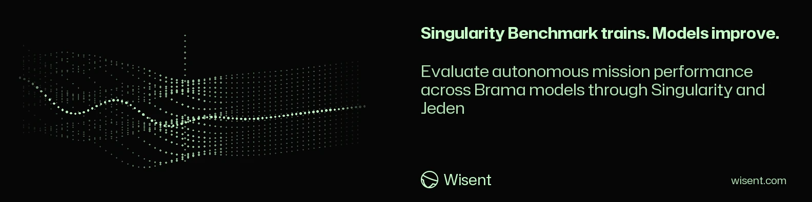

<!-- wisent-banner:start -->
<p align="center">
  
</p>
<!-- wisent-banner:end -->

<!-- wisent-readme-signals:start -->
[](https://github.com/wisent-ai/singularity-benchmark) [](https://github.com/wisent-ai/singularity-benchmark/issues) [](https://wisent.com) [](https://discord.gg/qRjpkthq54) [](https://www.linkedin.com/company/wisent-ai/) [](https://x.com/wisentai) [](https://calendly.com/lbartoszcze)
<!-- wisent-readme-signals:end -->

# Singularity Benchmark

`singularity-benchmark` compares every currently available tool-capable Brama model on the same deterministic external stimulus while Singularity retains its autonomous digital-being contract. Singularity owns the continuous cognition-and-tool loop, Brama owns authenticated model routing, and Las owns federated tool discovery.

## Inputs

- `dataset/benchmark.json` is the versioned evaluation contract.
- Each fixture is copied into an isolated workspace before a model sees it.
- The eligible model set comes from Jeden's signed, caller-scoped Brama catalogue cache after a fresh `jeden doctor --json` catalogue request.
- Only catalogue entries with `available=true` and `tools=true` run unless `--model` selects a smaller set.

## Run

Build the runner, then run it with Singularity's environment: for each case the runner passes only the arguments it owns (`--role`, `--environment`, `--host`, `--workload-id`, `--workspace`, `--stimulus`, `--state-dir` and `--brama-model`). Every other value `singularity once` needs, among them the being's identity (`SINGULARITY_AGENT_ID`, `SINGULARITY_AGENT_NAME`, `SINGULARITY_AGENT_TICKER`), the workload's `SINGULARITY_WORKLOAD_PUBLIC_KEY`, `SINGULARITY_EXECUTABLE_SHA256`, `SINGULARITY_CODE_SHA256`, `SINGULARITY_POLICY_SHA256` and `SINGULARITY_POLICY_SEQUENCE`, Brama's `BRAMA_BASE_URL` with `BRAMA_BEARER_TOKEN_FILE` or `BRAMA_HMAC_SECRET_FILE`, and the Las release files, is read by Singularity from the runner's environment. A missing one fails the case with Singularity's refusal naming it, recorded in the case's `error`.

```sh
cargo build --release --locked
target/release/singularity-benchmark \
  --singularity ../singularity/target/release/singularity \
  --output results
```

Use `--jobs` (or `SINGULARITY_BENCHMARK_JOBS`) to bound concurrent provider families; models sharing a provider prefix remain sequential so bounded subscription capacity cannot bias their verdicts. Each model also remains sequential across its cases. Use repeated `--model provider/model` arguments for a bounded comparison.

## Scoring

Every case combines:

- deterministic file or structural JSON graders;
- a hard workspace-boundary grader that rejects undeclared paths;
- a completion award only when Singularity reports `completed`;
- hard-failure counts independent of the numeric score.

Verdicts are `qualified`, `strong`, `partial`, or `refused`. Ranking sorts by score, hard failures, completed cases, latency, then model id. Latency breaks otherwise equal scores and is not folded into correctness.

The runner writes each completed model to `results/<timestamp>/<model>/result.json`, where `<model>` is the model id with every character other than a letter, digit, `-` or `_` replaced by `-`, then `-` and the SHA-256 of the id. It then assembles the run's canonical `report.json` and atomic `results/latest.json` pointer. Raw workspaces remain local and are ignored by Git. A failed case's `error` carries Singularity's whole stderr; Singularity reads Brama's bearer and request-signing secret from files, and the runner records neither value. The latest complete recorded comparison is published at `results/final-v1-2-qualified/latest.json`.

## Boundaries

The benchmark does not invoke arbitrary child tools. The Las case inspects the configured federated catalogue and records its surfaces without calling a child tool. Provider availability and subscription health remain Brama concerns; a routing refusal is recorded as a refused evaluation rather than credited as task behavior.
